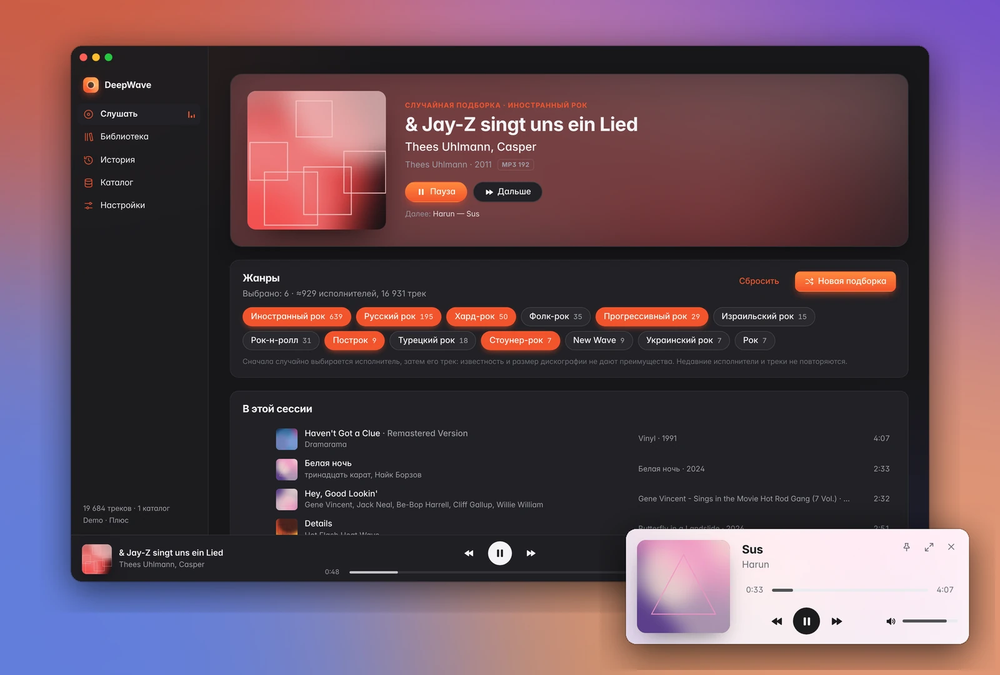
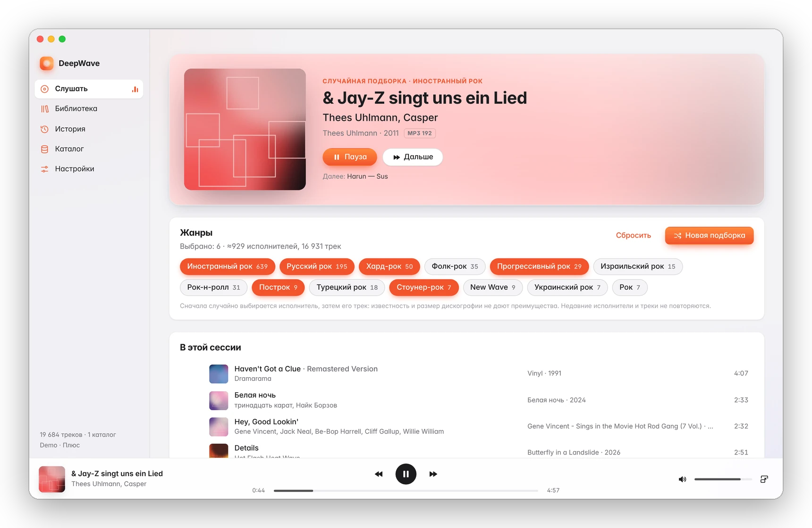
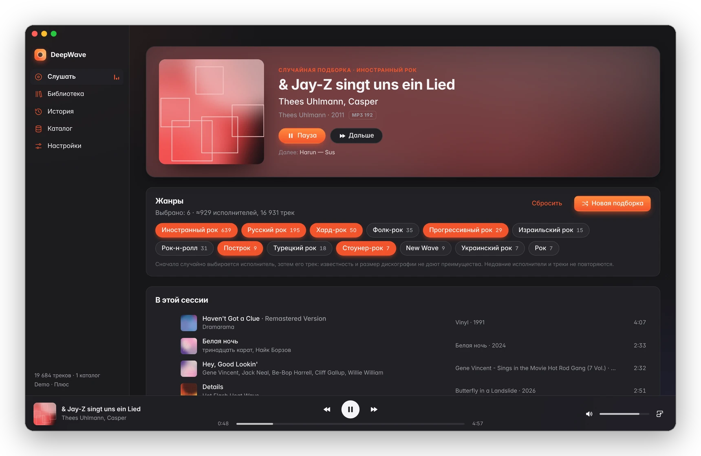
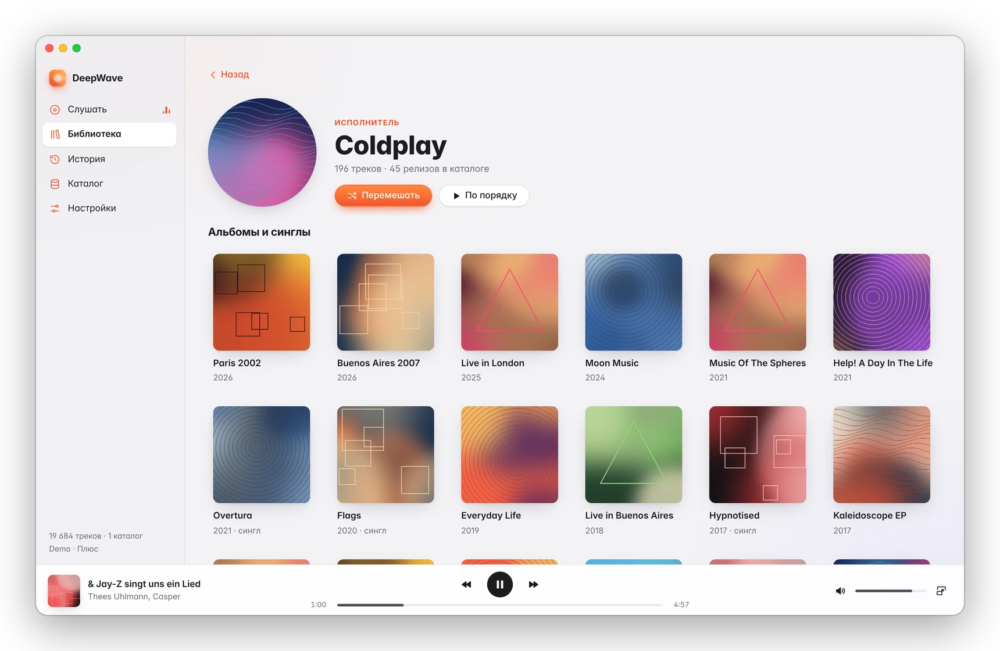
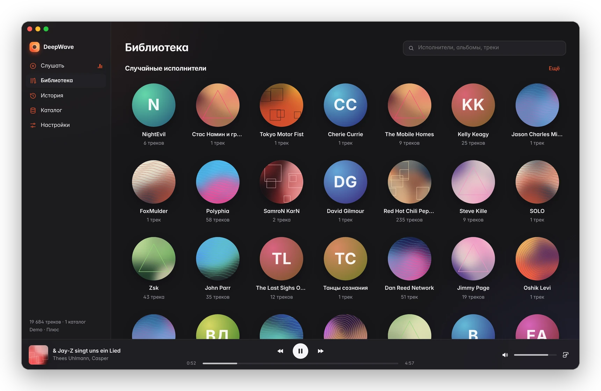
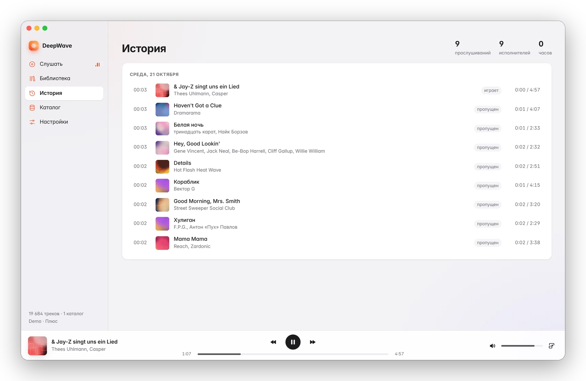
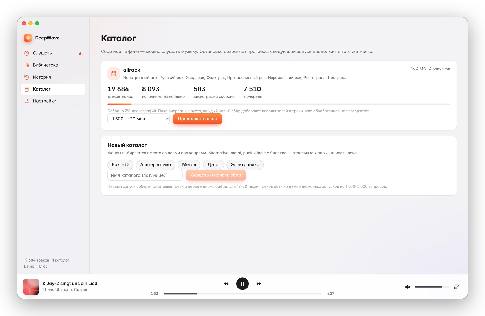
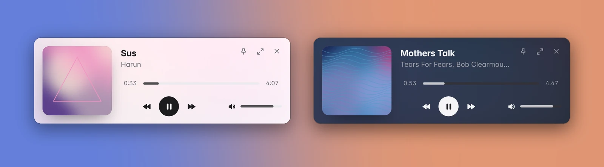

<h1 align="center">DeepWave</h1>

<p align="center"><b>Широкий и честный случайный эфир из каталога Яндекс Музыки — для Windows.</b><br>
Неофициальный настольный клиент: собирает каталог жанра целиком и играет всех исполнителей наравне.</p>

<p align="center">
  
</p>

**DeepWave** — настольный плеер для Windows, который слушает каталог Яндекс Музыки широко и непредсказуемо, без привязки к популярным подборкам и рекомендациям.

Приложение само собирает каталог выбранных жанров: находит исполнителей через жанровые страницы, похожих исполнителей, лейблы, соавторов и новинки, а затем сохраняет их полные дискографии. Воспроизводит оно случайно, но честно: **сначала равновероятно выбирается исполнитель, затем его трек**. Поэтому известность и размер дискографии не дают преимущества, а редкие записи известных групп и песни малоизвестных исполнителей звучат наравне с хитами.

> **DeepWave — независимый неофициальный клиент.** Проект не связан с ООО «Яндекс», не одобрен и не поддерживается им. «Яндекс Музыка» — товарный знак правообладателя. Приложение работает через неофициальную библиотеку [`yandex-music`](https://github.com/MarshalX/yandex-music-api). Для прослушивания нужен ваш собственный аккаунт Яндекса с подпиской Плюс. Используется только штатная выдача аудио: без обхода DRM, ограничений подписки и без скачивания музыки. Неофициальный API может измениться без предупреждения. Используйте приложение для личного прослушивания и на свой риск.

## Возможности
- **Жанры по группам:** Рок, Альтернатива, Инди, Метал, Панк, Ска и другие жанры Яндекса. Группу можно выбрать целиком одним нажатием или по отдельным поджанрам, например слушать только рок без примеси. Счётчики показывают уникальных исполнителей, реально доступных для воспроизведения, с учётом фильтра стран. Направления можно добавлять в уже собранный каталог: сохранённые треки сразу становятся доступны, резервная копия создаётся автоматически.
- **Честный случайный выбор.** Недавние исполнители и треки, а также другие версии недавно сыгранной песни не повторяются. Сколько не повторять, настраивается.
- **Непрерывное воспроизведение.** Следующий трек загружается заранее. Недоступные треки пропускаются автоматически. После обрыва сети воспроизведение восстанавливается само.
- **Библиотека.** Поиск по исполнителям, альбомам и трекам, страницы исполнителя и альбома.
- **История прослушивания.** Хранится только у вас, по ней DeepWave избегает повторов.
- **Сбор и расширение каталога прямо из приложения.** Прогресс виден, сбор можно остановить и потом продолжить с того же места.
- **Компактный плеер** (Ctrl+M) — маленькое окно поверх рабочего пространства. Воспроизведение при переключении не прерывается.
- **Фильтр по странам исполнителей:** «Все страны», «Только выбранные» или «Исключить выбранные», любое число стран, поиск, отдельная настройка для исполнителей с неизвестной страной. Страна берётся из карточки исполнителя в Яндекс Музыке, а если её там нет — из открытой базы [MusicBrainz](https://musicbrainz.org) со сверкой альбомов. По языку, жанру или названию страна не угадывается. Приложение показывает, у скольких исполнителей страна действительно определена.
- **Оформление в эстетике macOS.** Собственная рамка окна, светлая и тёмная темы, медиаклавиши и системная панель управления музыкой Windows.

## Скриншоты

<table>
  <tr>
    <td width="50%"></td>
    <td width="50%"></td>
  </tr>
  <tr>
    <td align="center"><sub><b>Слушать</b> — выбор жанров и честная случайная подборка</sub></td>
    <td align="center"><sub>Та же страница в тёмной теме</sub></td>
  </tr>
  <tr>
    <td></td>
    <td></td>
  </tr>
  <tr>
    <td align="center"><sub><b>Исполнитель</b> — все альбомы и треки из каталога</sub></td>
    <td align="center"><sub><b>Библиотека</b> — поиск и случайные исполнители</sub></td>
  </tr>
  <tr>
    <td></td>
    <td></td>
  </tr>
  <tr>
    <td align="center"><sub><b>История</b> — по ней DeepWave избегает повторов</sub></td>
    <td align="center"><sub><b>Каталог</b> — сбор и расширение прямо из приложения</sub></td>
  </tr>
</table>

<p align="center">
  <br>
  <sub><b>Компактный плеер</b> (Ctrl+M) — небольшая карточка поверх рабочих окон; музыка при переключении не прерывается</sub>
</p>

<sub>Скриншоты сделаны с реального интерфейса DeepWave на настоящем каталоге (названия треков и исполнителей — из Яндекс Музыки). Обложки на скриншотах — демонстрационные абстрактные изображения: оригинальные обложки альбомов принадлежат правообладателям. В приложении показываются настоящие обложки.</sub>

## Требования
- Windows 10/11 (x64).
- [Python](https://www.python.org/) 3.9+ с библиотекой `yandex-music` (`python -m pip install -U yandex-music`).
- [Node.js](https://nodejs.org/) LTS — нужен только для сборки (`winget install OpenJS.NodeJS.LTS`).
- Аккаунт Яндекса с подпиской Плюс.

## Установка
```powershell
git clone https://github.com/DS9-dev/DeepWave.git
cd DeepWave
.\setup_app.bat
```
Скрипт `setup_app.bat`:
1. проверит Python и Node.js;
2. скачает компоненты (Electron и др., около 150 МБ, только в первый раз);
3. соберёт приложение в `app\release\win-unpacked\DeepWave.exe`;
4. создаст ярлыки **DeepWave** на рабочем столе и в меню «Пуск» и запустит приложение.

Дальше DeepWave запускается ярлыком или файлом `DeepWave.bat`. Python-сервис приложение запускает и закрывает само, без консольных окон.

**Первый запуск.** Нажмите «Войти через Яндекс» и введите показанный код на странице Яндекса. Логин и пароль вводятся только на сайте Яндекса. Затем в разделе **«Каталог»** создайте каталог жанра (например, «Рок») и запустите сбор. Для 19–20 тысяч треков обычно хватает нескольких запусков по 1 500–5 000 запросов. Слушать можно, не дожидаясь окончания сбора.

**Обновление.** Выполните `git pull` и снова запустите `setup_app.bat`. Каталог, история, настройки и вход в Яндекс сохраняются: всё это лежит вне собираемых файлов.

Подробная инструкция — в [APP.md](APP.md).

## Где хранятся данные
| Что | Где | В Git? |
|---|---|---|
| Музыкальные каталоги (`*.sqlite`) | `catalog\` в папке проекта | нет |
| История, статистика, настройки, журнал сервиса | `catalog\app_state.sqlite`, `catalog\app_backend.log` | нет |
| Токен Яндекса (зашифрован Windows DPAPI) | `%USERPROFILE%\.yandex_music_token.dpapi` | нет |
| Размер и режим окна, путь к Python, кеш обложек | `%APPDATA%\DeepWave\` | нет |

DeepWave рассчитан на годы ежедневного прослушивания и сам следит за местом на диске:
- **Подробная история.** Хранится 12 месяцев (в настройках можно выбрать 3, 6, 12 месяцев или «бессрочно»). Счётчики прослушиваний по трекам и защита от повторов сохраняются всегда.
- **Кеш обложек и фото исполнителей.** Не больше 256 МБ, старое вытесняется автоматически. В настройках видно занятое место и есть кнопка «Очистить кеш».
- **Журналы сервиса.** Не больше ~2 МБ каждый (текущий файл и один предыдущий).
- **Обслуживание.** Выполняется в фоне через минуту после запуска и затем раз в 6 часов, не мешая воспроизведению.
- **Аудио не сохраняется на диск.**

## Устройство
```
app/          Electron + TypeScript + React: окно, интерфейс, аудиодвижок
backend/      локальный Python-сервис (127.0.0.1, доступ только по одноразовому ключу):
              индекс каталога, честный случайный выбор, поток mp3, история, фоновые задачи
crawler.py    накопительный сборщик каталога (работает и из приложения, и из командной строки, см. CRAWLER.md)
ym_auth.py    вход через код на сайте Яндекса и хранение токена
*_probe.py, catalog_depth.py, REPORT*.md   исследования API, из которых вырос проект
```
Разработка: `cd app`, `npm install`, затем `npm start` (запуск без сборки exe) или `npm run typecheck`.

## Лицензия
Код проекта распространяется по лицензии [MIT](LICENSE).

Сторонние компоненты:
- Electron, React, esbuild, electron-builder — MIT;
- TypeScript — Apache-2.0;
- шрифт Inter — SIL OFL 1.1;
- Python-библиотека `yandex-music` — LGPL-3.0;
- `requests` — Apache-2.0.

Библиотеки Python не входят в репозиторий и устанавливаются пользователем отдельно.

Ранее проект назывался «Music App»: это название встречается в исследовательских отчётах.
